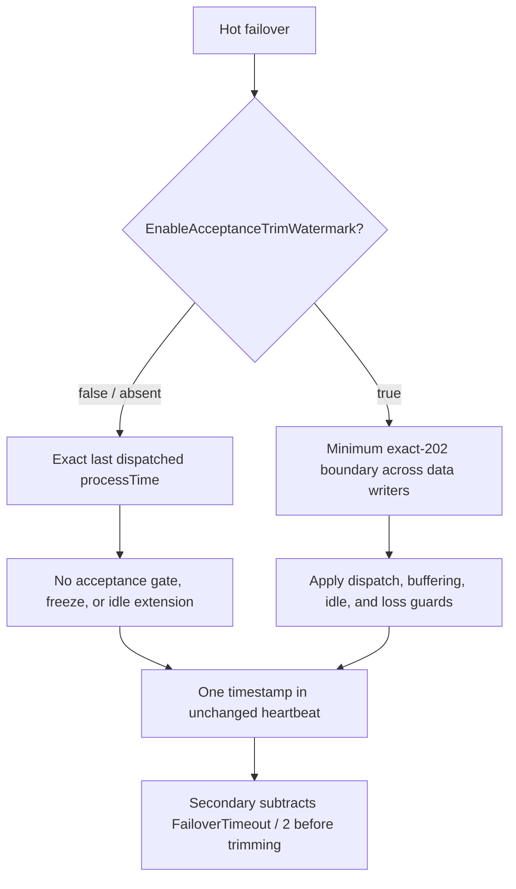

# Awaitable acceptance with hot failover

**Updated:** 2026-10-19.

Awaitable scopes require OMF 2.0. Scopes in hot failover additionally require explicit opt-in through
`ClientFailoverConfiguration.EnableAcceptanceTrimWatermark` on **both nodes**. This Boolean
defaults to `false`; an absent property also means `false`, preserving existing writers' behavior.
When enabled, hot scopes work in primary and secondary roles, including scopes created before a
failover-mode change. A scope is an in-process observation, not a durable checkpoint, and does not
survive process restart.

## Configuration and compatibility

Merge this property-only JSON fragment into each node's **existing client failover configuration**;
it is not a complete configuration and does not replace existing connection or authentication settings:

```json
{
  "EnableAcceptanceTrimWatermark": true
}
```

| Policy | Default / `false` | Opt-in / `true` |
| --- | --- | --- |
| Hot heartbeat watermark | Exact last dispatched `processTime`; no acceptance checks, acceptance freeze, or idle extension | Phase 6 acceptance boundary across all bodies, including unscoped traffic |
| Unscoped hot output to endpoint writers | `ProcessTimeTicks = 0`, `SerializedMessageId = null`; writer V3 as before | Timestamped output; writer V5 |
| Local hot failover buffer | Still retains local process ticks for legacy trimming | Retains process ticks and scoped identity where present |
| Hot scope factory | Throws `NotSupportedException` | Supported in either role with OMF 2.0 |
| Warm/cold scope factory | Unchanged; supported with OMF 2.0 | Unchanged; supported with OMF 2.0 |

`TryCreateScope` returns `false` **only** for capacity exhaustion, not for an unsupported hot
configuration. The single-parameter `UpdateMode(mode)` retains legacy behavior; the new
`UpdateMode(mode, bool)` overload explicitly selects acceptance tracking.



## Runtime setting changes

- Disabling the setting while hot completes pending buffered observations as `Discarded` with
  `Failover/AcceptanceTrackingDisabled` (numeric reason code **18**). The physical data remains
  buffered and can still be sent or trimmed under legacy rules; this outcome does not cancel delivery.
- A scope predating a switch into legacy hot mode also receives this explicit discard when its body
  materializes. A mixed body can fail its scope observation without cancelling delivery of that body.
- Already dispatched deliveries retain exact-202 tracking when hot acceptance tracking is disabled.
  This differs from leaving hot mode, which deletes remaining failover-buffered data (`BufferDeleted`).
- Enabling cannot recover data already trimmed under legacy rules. Existing conservative tracker
  freezes are not cleared by toggling the setting: runtime enabling may leave the boundary at zero
  after earlier losses and require deliberate recovery, not another toggle.

Prefer a coordinated collection pause/maintenance window, or drain the pair and restart both nodes
with the setting enabled. Do not treat an uncoordinated runtime toggle as a safe migration.

Configuration sequencing is unchanged: ordinary updates configure the failover endpoint before
applying processor mode and policy, then initiate mode-change callbacks. Removal retains its existing
apply/notify-before-endpoint path. Registration may invoke role callbacks before ordinary mode/policy
application finishes; this change does not introduce a transactional or collection-quiescing lifecycle.

## Completion and diagnostics

The following hot-buffer outcomes apply to the enabled acceptance policy.

- A body sent locally completes on an exact HTTP 202. Other terminal responses are not acceptance.
- A body held in the hot failover buffer is pending with `Failover/AwaitingPeerCoverage`.
  Its delivery has no endpoint ID, target URI, HTTP status, or receipt until it is dispatched.
- Promotion replaces the pending failover placeholder with the actual endpoint-writer snapshot.
- Trimming completes the buffered body as `PeerCovered`, without inventing an HTTP receipt.
  A scope mixing local acceptance and peer coverage completes as `PeerCovered` in either endpoint mode.
- Leaving hot mode (including configuration removal) discards remaining buffered bodies with
  `Failover/BufferDeleted`. Already dispatched deliveries are unaffected.
- Buffer overflow, unreadable records, and failed enqueue/spill operations report explicit losses.
  A disk flush error that retains the body does not discard it.

Shutdown preserves buffered disk records without reporting buffer deletion; the coordinator's
normal shutdown cancels waits. Restarted processes create new scopes. Old persisted IDs cannot
reattach to scopes from a previous process.

## Acceptance watermark

With `EnableAcceptanceTrimWatermark = true`, hot-mode heartbeats advertise acceptance rather than
writer hand-off time. Every hot body, including unscoped
traffic, receives a monotonic local process timestamp. Each writer tracks outstanding timestamps
across both its metadata and data queues. Only an exact 202 releases a timestamp. While a body is
pending, the inclusive boundary is at most one tick before its timestamp. The endpoint manager
reports the minimum across every dispatched data endpoint, regardless of a scope's endpoint mode.
The failover processor also caps progress at its last dispatched body until all dispatched bodies
are accepted. A fully accepted primary advances through idle time, bounded by the next buffered
body (if any), so a finite batch can cross the trim offset without more data arriving.

The failover service protocol and existing `FailoverTimeout / 2` subtraction are unchanged.
The secondary marks peer coverage only when the adjusted boundary actually trims the local body.

Safety takes precedence over trimming progress:

- No endpoints, or an endpoint manager without acceptance support, yields a zero boundary.
- Pending legacy bodies without timestamps block progress until their exact 202s arrive.
- After restart with writer backlog, progress stays zero until both writer queues drain together
  under the admission lock. Newly admitted bodies also participate. Recovery resumes automatically
  after this loss-free drain; continuous input can prolong it.
- Terminal non-202 responses, buffer losses, startup repair that may have lost records, and enqueue
  failures freeze the safe boundary. Tracking is released after a permanent gap to keep memory bounded.
- Endpoint removal, URL update, reset, or writer creation failure conservatively caps the manager's
  boundary for its lifetime. Removing a failed writer must not authorize trimming its unaccepted data.
- Loss from the failover buffer blocks that processor's local boundary, even for unscoped traffic.

These conservative caps can retain secondary backlog and eventually reach buffer limits. Restoring
an endpoint or receiving newer 202s does not prove acceptance of a permanently lost body. Operators
must resolve the gap and source-checkpoint implications before restarting or clearing buffers.

## Deployment and operational prerequisites

1. Upgrade **both nodes** and set `EnableAcceptanceTrimWatermark = true` on both before relying on
  peer coverage. There is no heartbeat capability/version or settings negotiation: an older primary
  or a current primary with the setting disabled advertises hand-off time. A secondary cannot
  distinguish that unsafe legacy boundary from acceptance. Mixed versions or mismatched settings
  are unsafe for acceptance-based peer coverage; use coordinated maintenance or restart after drain.
2. Synchronize node clocks within **`FailoverTimeout / 2`**. The comparison uses the two nodes'
  wall-clock timestamps; local monotonic ordering does not remove cross-node clock skew. Both
  nodes must collect equivalent source data, and the retained overlap must also cover relative
  collection lag. Clock synchronization alone does not prove peer coverage.
3. Give the secondary at least as much effective buffer capacity as the primary's outstanding
   backlog, accounting for endpoint-writer buffers. Overflow can still lose data.
4. Use source-derived item IDs, stream IDs, and timestamps. Acceptance does not deduplicate
   independently generated IDs or restore ordering between nodes.

With these prerequisites and no buffer loss, handover is at-least-once, not exactly-once. Nodes can
send duplicates and messages can arrive out of order. An acceptance result confirms local acceptance
or coverage by the peer's watermark; it does not prove that no other copy was sent or that the copy
is newest. Update/delete workloads should resend current source state after a role change.

This change does not add split-brain fencing, stop demoted writers from draining, or share source
checkpoints between nodes.

## Disk formats and rollback

- Writer V3 and V4 layouts are unchanged. V4 remains the ID-only format for scoped bodies without
  process timestamps.
- Writer **V5** is the V3 layout followed by 8-byte process ticks and a fixed 16-byte GUID.
  An empty GUID means no scoped ID. Timestamped unscoped opt-in hot traffic also uses V5;
  default legacy hot unscoped output remains V3 with zero writer ticks and a null ID.
- Failover V2 and V3 remain readable. Scoped failover **V4** appends the 16-byte ID to the existing
  V3 payload, which already contains process ticks, partition key, action, and OMF version.

Older writer builds skip unknown V5 records as corrupt. Older failover readers cannot interpret
scoped V4 payloads correctly. **Drain or delete both endpoint and failover buffers before rollback**;
deleting buffers loses those bodies. Never silently reinterpret the previously implemented writer
V4 format as a timestamp-bearing record.