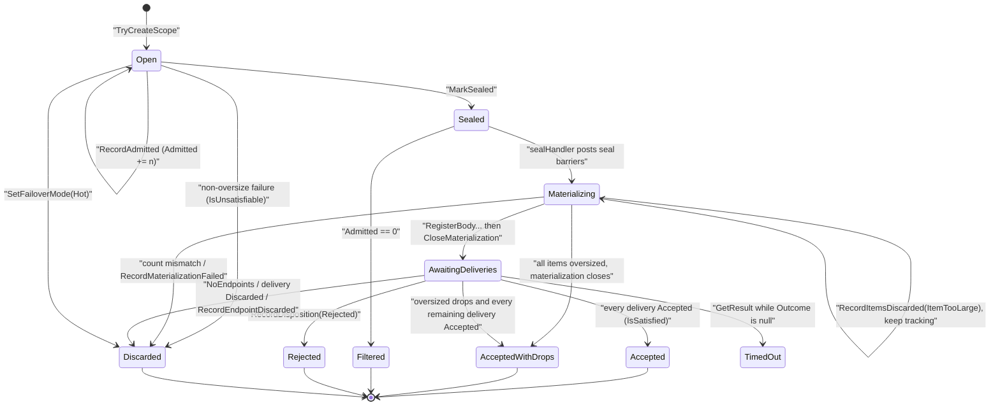

> **Note:** `AcceptedWithDrops` is a loss-tolerant terminal outcome, not proof that any endpoint accepted data. When every admitted item is oversized, materialization closes with no bodies, no deliveries, and no HTTP call for the scope. See [Choosing a success policy](ScopedWrites.md#choosing-a-success-policy).