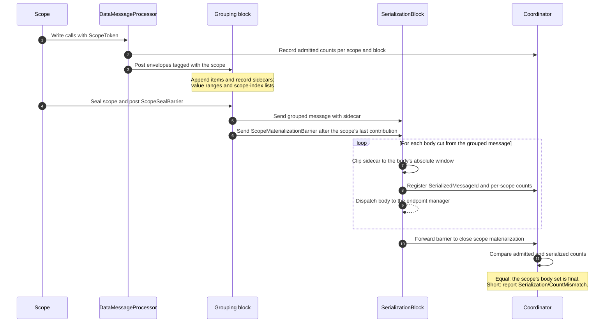
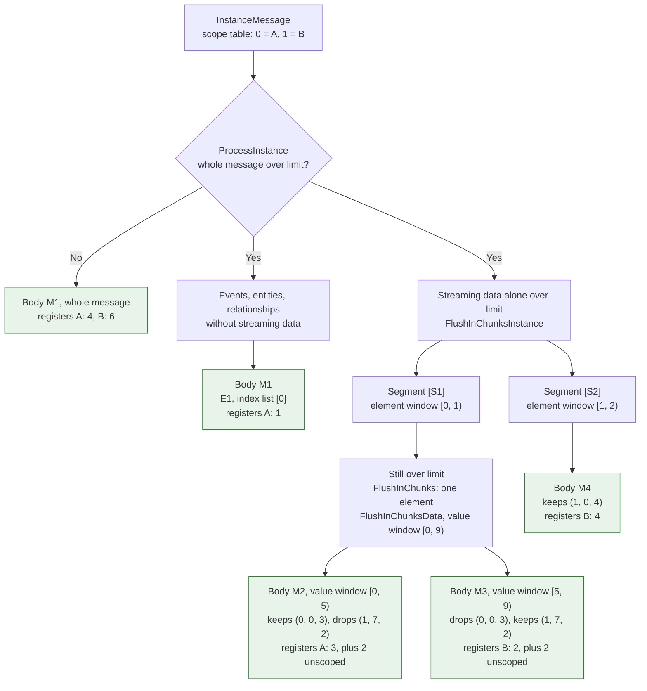
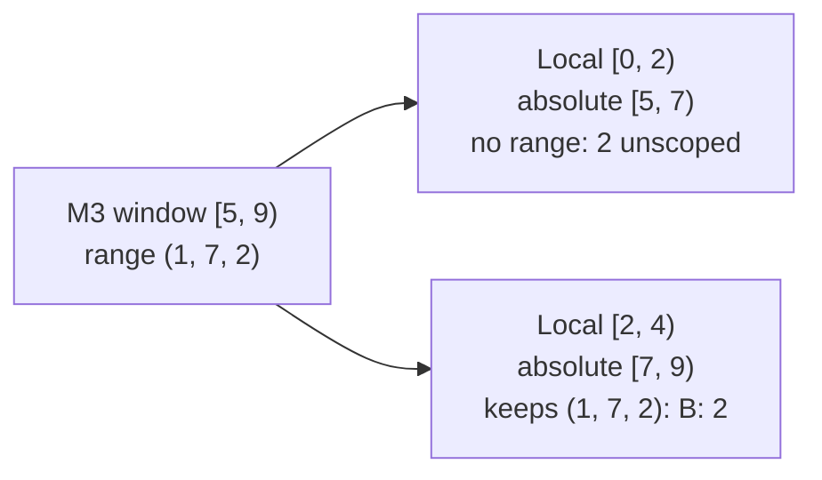
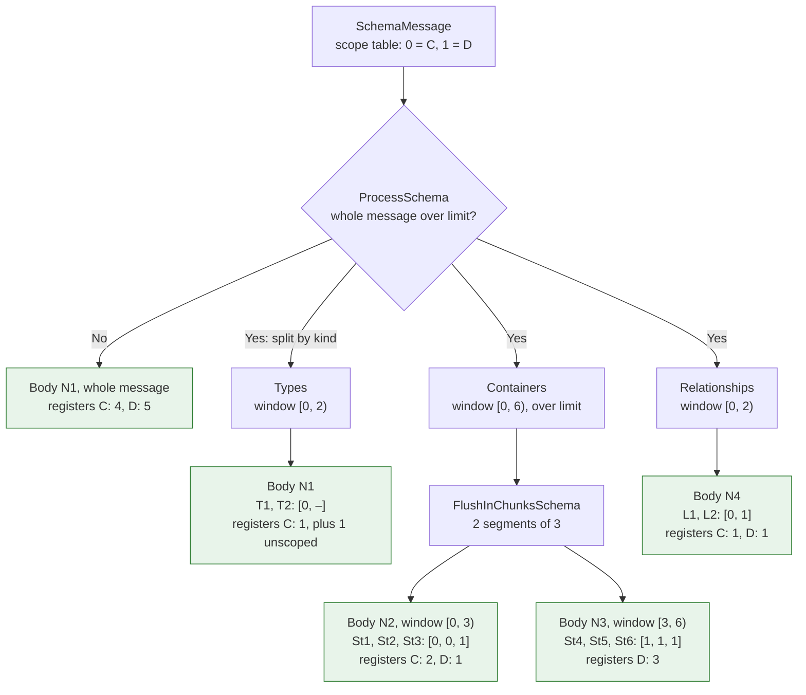
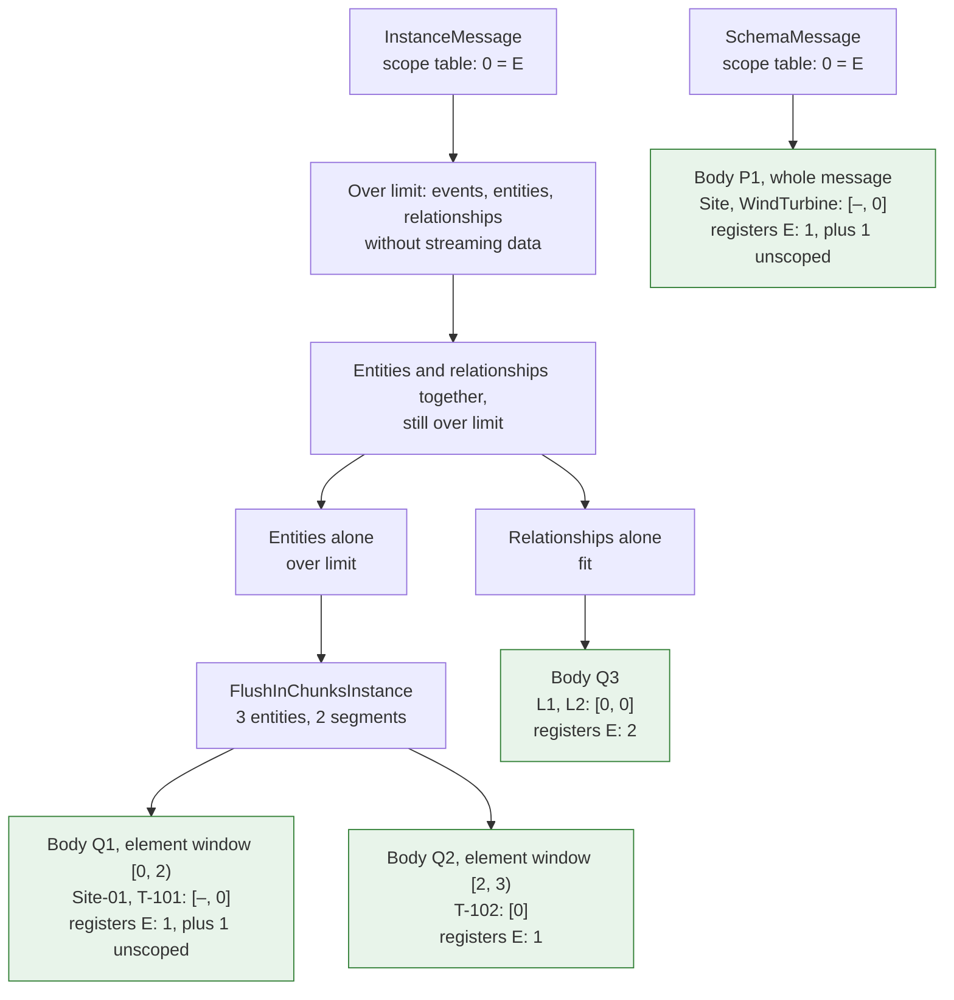
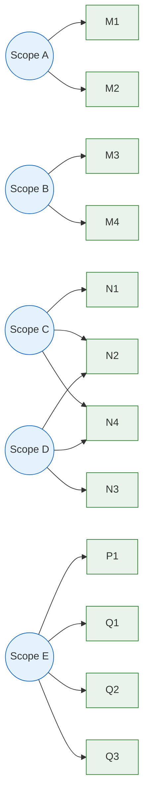

# Sidecar slicing walkthrough: scope tracking through grouping and serialization

## Purpose and scope

This walkthrough explains how OpenAFx tracks scoped writes as data moves through grouping and serialization. It follows three examples: streaming values, schema items, and static data together with its type. It describes how a scope's items are counted when admitted, tagged in grouped messages, split across serialized HTTP bodies, and counted again so the coordinator can determine when the complete set of bodies for a scope is known.

The explanation is self-contained. It defines the terms and pipeline stages used below and does not rely on another repository, document, or plan. The class names are included to identify the OpenAFx components responsible for the described behavior; line numbers and external document references are intentionally omitted.

## 1. Key ideas

| Term | Meaning |
| --- | --- |
| Scope | A logical unit of work whose writes are tracked together until the system can report their materialization and delivery outcome. |
| Scope table | A small per-grouped-message list of scopes, for example `[0: A, 1: B]`. Sidecars refer to a scope by its index in this table. |
| Sidecar | Metadata carried alongside a grouped message that associates its items, or ranges of values, with scopes. |
| Value range | `(scopeIndex, start, count)` over one stream's value list. The values contributed by one envelope to a stream form one contiguous run. |
| Scope-index list | One scope index per item in a discrete list, such as types, streams, relationships, entities, or events. `–` means unscoped. |
| Absolute window | The part of the original grouped message covered by a split: `[a, a + n)`. Value ranges are clipped to this window and are not rebased. |
| Admitted count | The number of scoped items accepted by the grouping pipeline for a scope. |
| Registration | A mapping from a serialized message ID to per-scope item counts, sent to the coordinator before the body is dispatched. |
| Materialization barrier | A signal that no more grouped contributions for a scope will be registered from a grouping block. Once all relevant barriers arrive, the coordinator can compare admitted and serialized counts. |
| Count check | The coordinator compares the admitted item count with the total registered in serialized bodies. A shortfall is reported as `Serialization/CountMismatch`. |

For a value window `[a, a + n)`, clip an original range `(scopeIndex, start, count)` as follows:

$$
start' = \max(start, a), \qquad count' = \min(start + count,\ a + n) - start'
$$

If $count' \le 0$, the range does not contribute to that body and is omitted from its sidecar.

## 2. End-to-end scope tracking

A caller creates or enters a scope and submits writes with its scope token. The data processor records admitted item counts and sends envelopes to grouping blocks. A grouping block combines envelopes into a grouped message and records a sidecar that preserves the scope association. When a scope is sealed, barriers are posted so downstream processing can determine when that scope has no further grouped contributions. Serialization may split a grouped message into multiple HTTP bodies; for each body it clips the sidecar to the body's window and registers the resulting per-scope counts with the coordinator before dispatch.



A successful count check establishes that all admitted scoped items are represented in the set of serialized bodies. Delivery acceptance is tracked separately: the coordinator waits for the relevant body outcomes after materialization closes.

## 3. Instance example: streaming values

### 3.1 Writes and admitted counts

Assume two streams, `S1` and `S2`. Scope A writes three values to `S1` and one event. An unscoped write adds four values to `S1`. Scope B writes two values to `S1` and four values to `S2`.

| Order | Writer | Items | Admitted |
| --- | --- | --- | --- |
| 1 | Scope A | 3 values to S1, event E1 | A = 4 |
| 2 | Unscoped | 4 values to S1 | – |
| 3 | Scope B | 2 values to S1, 4 values to S2 | B = 6 |

### 3.2 Grouped `InstanceMessage` and its sidecar

The grouped message has the scope table `[0: A, 1: B]`. Each stream's values are listed in their original order. Sidecar ranges point to the contiguous positions contributed by each scope. The event is a discrete item and carries one scope index.

```text
S1 values   index:  0   1   2   3   4   5   6   7   8
            owner:  A   A   A   -   -   -   -   B   B
            ranges: (0, 0, 3)                   (1, 7, 2)

S2 values   index:  0   1   2   3
            owner:  B   B   B   B
            ranges: (1, 0, 4)

Events      E1 -> scope index [0]
```

### 3.3 Slicing an oversized message

Assume the values for `S1` alone exceed the configured body limit and require two bodies, while `S2` and event `E1` are small. Serialization first handles the non-streaming items and then slices streaming data. The windows are absolute positions in the original `S1` values.



`S1`'s split point in absolute positions is:

```text
            M2: window [0, 5)            M3: window [5, 9)
         |---------------------------|-----------------------|
index:     0   1   2   3   4           5   6   7   8
owner:     A   A   A   -   -           -   -   B   B
kept:      (0, 0, 3)                           (1, 7, 2)
```

The range for A overlaps only the first body; the range for B overlaps only the second. Unscoped values remain in the bodies but do not add to a scope's registered count.

### 3.4 Nested split: absolute windows compose

If M3 is still too large, `FlushInChunksData` can split its four-value array again. The local windows are mapped back to absolute positions before clipping the sidecar. This preserves the original range coordinates:



### 3.5 Coordinator tally

| Scope | Admitted | Bodies | Serialized | Result |
| --- | --- | --- | --- | --- |
| A | 4 | M1 (1), M2 (3) | 4 | Materialization closes; delivery acceptance waits on M1 and M2. |
| B | 6 | M3 (2), M4 (4) | 6 | Materialization closes; delivery acceptance waits on M3 and M4. |

If B's value at index 8 were too large to send by itself, `FlushInChunksData` would drop it. Since index 8 belongs to the range `(1, 7, 2)`, the coordinator records one discarded item for B with `Serialization/ItemTooLarge`.

## 4. Schema example: types, streams, and relationships

### 4.1 Writes and admitted counts

Scope C writes type T1, which embeds relationship L1, and streams St1 and St2. Scope D writes streams St3 through St6 and relationship L2. An unscoped write adds type T2.

| Order | Writer | Items | Admitted |
| --- | --- | --- | --- |
| 1 | Scope C | Type T1, which embeds relationship L1 | C += 2 (T1 and L1) |
| 2 | Scope C | Streams St1, St2 | C += 2 |
| 3 | Unscoped | Type T2 | – |
| 4 | Scope D | Streams St3, St4, St5, St6 | D += 4 |
| 5 | Scope D | Relationship L2 | D += 1 |

`SchemaGroupingBlock` clones T1 and moves L1 into its relationship list. L1 retains T1's scope index, and the block adds L1 to C's admitted count so the serialized count can balance. The totals are C = 4 and D = 5.

### 4.2 Grouped `SchemaMessage` and its sidecar

The scope table is `[0: C, 1: D]`:

```text
Types          T1   T2
scope index    0    -

Containers     St1  St2  St3  St4  St5  St6
scope index    0    0    1    1    1    1

Relationships  L1   L2
scope index    0    1
```

Schema items are discrete, so their sidecar contains one scope index per item. Value ranges are not needed.

### 4.3 Slicing an oversized message

Assume the types and relationships fit in separate bodies, but the streams exceed the limit and are split into two segments.



The containers' split point is:

```text
             N2: window [0, 3)        N3: window [3, 6)
          |----------------------|----------------------|
element:    St1   St2   St3        St4   St5   St6
scope:      C     C     D          D     D     D
```

### 4.4 Coordinator tally

| Scope | Admitted | Bodies | Serialized | Result |
| --- | --- | --- | --- | --- |
| C | 4 | N1 (1), N2 (2), N4 (1) | 4 | Materialization closes; delivery acceptance waits on N1, N2, and N4. |
| D | 5 | N2 (1), N3 (3), N4 (1) | 5 | Materialization closes; delivery acceptance waits on N2, N3, and N4. |

A scope's schema items can appear in bodies of different kinds. Its delivery outcome therefore depends on all bodies that contain its items.

## 5. Element example: static data and its type

In OMF 2.0, an element is static data, also called an entity, and its type is schema. In OpenAFx, type writes and static-value writes travel through separate grouping blocks. A scope that writes both can therefore contribute to both a schema message and an instance message.

### 5.1 Writes, routing, and admitted counts

`DataMessageProcessor` routes types to `SchemaGroupingBlock` and static values to `InstanceGroupingBlock`.

| Order | Writer | Call | Routed to | Admitted |
| --- | --- | --- | --- | --- |
| 1 | Unscoped | `WriteType(Site)` | `SchemaGroupingBlock` | – |
| 2 | Unscoped | `WriteStaticValue(Site, "Site-01", …)` | `InstanceGroupingBlock` | – |
| 3 | Scope E | `WriteType(WindTurbine)` | `SchemaGroupingBlock` | E += 1 in the schema block |
| 4 | Scope E | `WriteStaticValue(WindTurbine, "T-101", …, relationships: [L1: Site-01 → T-101])` | `InstanceGroupingBlock` | E += 2 in the instance block (T-101 and L1) |
| 5 | Scope E | `WriteStaticValue(WindTurbine, "T-102", …, relationships: [L2: Site-01 → T-102])` | `InstanceGroupingBlock` | E += 2 in the instance block (T-102 and L2) |

`InstanceGroupingBlock.ProcessStaticData` copies each entity's relationships into the block's relationship list and stores the entity without them. Each relationship inherits its entity's scope index, and the block adds it to E's admitted count. The entity, but not its relationships, counts toward the instance block's entity batch limit.

E's admitted total is 5: one type in the schema block, plus two entities and two relationships in the instance block. Sealing E posts a seal barrier to both blocks.

### 5.2 Grouped messages and their sidecars

When the instance block flushes, it sends a forced-flush command to the schema block. Types written before the elements therefore usually flush alongside them, but remain in a separate `SchemaMessage`. The command is queued, so the `SchemaMessage` can reach serialization after the `InstanceMessage`.

`SchemaMessage`, scope table `[0: E]`:

```text
Types          Site   WindTurbine
scope index    -      0
```

`InstanceMessage`, scope table `[0: E]`:

```text
Entities       Site-01   T-101   T-102
scope index    -         0       0

Relationships  L1        L2
scope index    0         0
```

Each grouped message has its own scope table. E is index 0 in both because it is the only scope in each message.

### 5.3 Slicing

The `SchemaMessage` fits and is sent whole as body P1, which registers E: 1. If the `InstanceMessage` fits, it becomes one body that registers E: 4. Otherwise, assume the entities exceed the limit and require splitting while the relationships fit. This case has no streaming data or events.



The configured tuning factor splits three entities with `factor = 2` into segments of two and one. The entity split point is:

```text
             Q1: window [0, 2)        Q2: window [2, 3)
          |----------------------|-----------|
element:    Site-01   T-101        T-102
scope:      -         E            E
```

### 5.4 Coordinator tally

| Scope | Admitted | Bodies | Serialized | Result |
| --- | --- | --- | --- | --- |
| E | 5 | P1 (1), Q1 (1), Q2 (1), Q3 (2) | 5 | Materialization closes after barriers from both blocks; delivery acceptance waits on P1, Q1, Q2, and Q3. |

Important consequences:

- **One scope, two blocks.** E's materialization closes only after its barriers from both the schema and instance blocks reach serialization.
- **Dependent items can be in separate bodies.** L1 in Q3 refers to T-101 in Q1, and both entities depend on WindTurbine in P1. Each body is delivered and accepted separately. E is accepted only when all four bodies are accepted; if P1 is rejected, E is rejected even if Q1–Q3 are accepted.
- **Unscoped neighbors share bodies.** Site and Site-01 share bodies P1 and Q1 with E's items. They contribute to body size but not to a scope's count.

## 6. Scope-to-body map

The following map shows the bodies associated with each scope after materialization closes:



Each body is dispatched to every endpoint captured for that delivery. A scope's acceptance completes when the configured endpoint mode is satisfied for every body associated with that scope.

## 7. Edge cases

- **Different actions or partition keys.** Both grouping blocks flush when the message action changes. The instance block also emits one grouped message per partition key. Each grouped message has its own scope table and sidecar, and the materialization barrier follows the scope's last grouped message.
- **Mid-envelope flush.** A bulk write that reaches the batch limit can flush partway through its envelope. The value run closes in one grouped message and continues in the next.
- **Oversized single schema or discrete instance item.** The current recursive chunking path can recurse without progress when a one-item segment is still too large. A guard should record `Serialization/ItemTooLarge` for the item's scope rather than retrying the same segment indefinitely.
- **Unscoped data.** Unscoped values and items can share bodies with scoped ones. They affect body size but do not contribute to any scope's admitted or serialized count.
- **Scope spanning multiple blocks.** A scope can contribute to schema and instance messages. It is not fully materialized until every relevant block has reported its barrier.
- **Nested value splits.** Local windows must be translated back to absolute positions before the sidecar is clipped, so nested splits continue to identify the correct original values.
